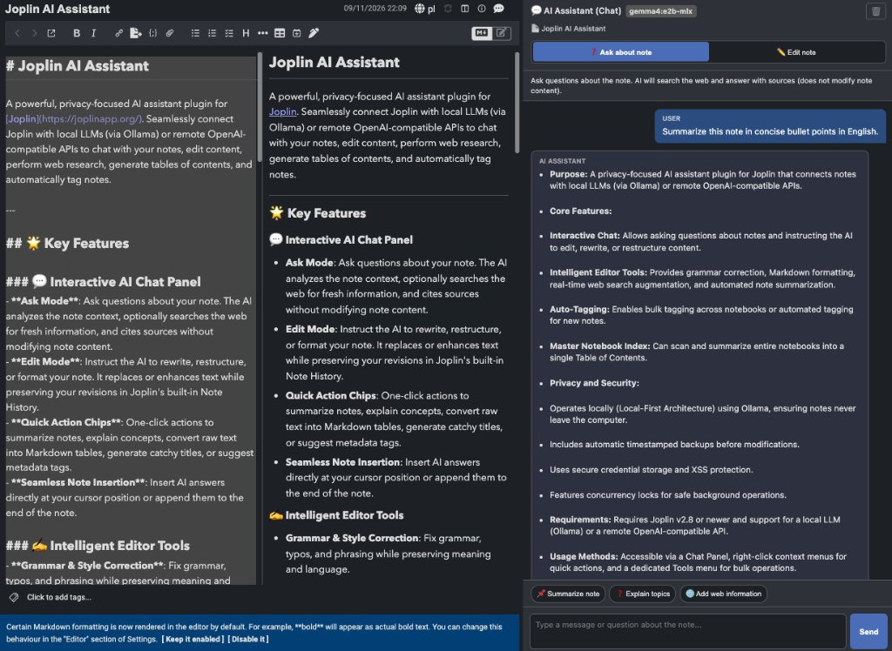

# Joplin AI Assistant

A powerful, privacy-focused AI assistant plugin for [Joplin](https://joplinapp.org/). Seamlessly connect Joplin with local LLMs (via Ollama) or remote OpenAI-compatible APIs to chat with your notes, edit content, perform web research, generate tables of contents, and automatically tag notes.



---

## 🌟 Key Features

### 💬 Interactive AI Chat Panel
- **Ask Mode**: Ask questions about your note. The AI analyzes the note context, optionally searches the web for fresh information, and cites sources without modifying note content.
- **Edit Mode**: Instruct the AI to rewrite, restructure, or format your note. It replaces or enhances text while preserving your revisions in Joplin's built-in Note History.
- **Quick Action Chips**: One-click actions to summarize notes, explain concepts, convert raw text into Markdown tables, generate catchy titles, or suggest metadata tags.
- **Seamless Note Insertion**: Insert AI answers directly at your cursor position or append them to the end of the note.

### ✍️ Intelligent Editor Tools
- **Grammar & Style Correction**: Fix grammar, typos, and phrasing while preserving meaning and language.
- **Markdown Formatting**: Convert unstructured notes into clean, readable Markdown with proper headers and bullet points.
- **Web Search & Augmentation**: Select any topic in your note to run real-time web searches (via Tavily or Serper.dev) and enrich the text with cited sources `[1]`, `[2]`.
- **Note Summaries**: Generate concise bulleted summaries saved directly to a dedicated notebook.
- **Master Notebook Index**: Scan and summarize entire notebooks into a single, organized Table of Contents note.

### 🏷️ Intelligent Auto-Tagging
- Run bulk AI tagging across your notebook collection or enable automated background tagging for newly created notes.
- Automatically reuses existing tags to avoid duplicate or redundant labels.

### 🔒 Privacy & Security by Design
- **Local-First Architecture**: Run 100% locally with [Ollama](https://ollama.com/) — your private notes never leave your computer.
- **Automatic Backups**: Before modifying any note, the plugin automatically creates a timestamped backup in a dedicated notebook.
- **Secure Credentials**: All API keys are stored securely using Joplin's masked credential settings.
- **XSS Protection**: Sanitized HTML rendering in the webview side panel.
- **Concurrency Locks**: Safe background task handling prevents race conditions during note updates.

### 🌐 Bilingual Support
- Full interface, menu, and prompt support for both **English** and **Polish** (switchable in plugin settings).

---

## 🚀 Getting Started

### 1. Requirements
- **Joplin**: v2.8 or newer.
- **AI Model**:
  - **Local (Recommended)**: [Ollama](https://ollama.com/) installed and running locally.
  - **Remote**: Any OpenAI-compatible endpoint (OpenAI, OpenRouter, Groq, etc.).

### 2. Quick Setup with Ollama (Local & Free)
1. Install and start [Ollama](https://ollama.com/).
2. Pull your preferred model in your terminal, for example:
   ```bash
   ollama pull llama3.3
   # Or lightweight / fast alternatives:
   # ollama pull llama3.2
   # ollama pull qwen2.5:7b
   # ollama pull deepseek-r1:8b
   ```
3. In Joplin, open **Tools > Options > AI Assistant**.
4. Set **AI Mode** to `Local Ollama` (default URL: `http://127.0.0.1:11434` or `http://localhost:11434`).
5. Click **Select model from local Ollama** or type `llama3.3` (or `llama3.2`, `qwen2.5:7b`, `deepseek-r1:8b`).

### 3. Setup with Remote API (OpenAI / OpenRouter)
1. In Joplin, open **Tools > Options > AI Assistant**.
2. Set **AI Mode** to `Remote API (OpenAI compatible)`.
3. Enter your **Remote API URL** (e.g. `https://api.openai.com/v1` or `https://openrouter.ai/api/v1`).
4. Enter your **Remote API Key**.
5. Set your chosen model name (e.g. `anthropic/claude-3.7-sonnet`, `gpt-4o`, `deepseek/deepseek-r1`, `google/gemini-2.5-flash`, `o3-mini`).

### 4. (Optional) Web Search Integration
To enable live web search capabilities:
1. Obtain an API key from [Tavily](https://tavily.com/) or [Serper.dev](https://serper.dev/).
2. Select your provider in **Tools > Options > AI Assistant**.
3. Paste your API key into the designated field.

---

## 🛠️ Usage

- **Toggle Chat Panel**: Click the AI icon or command `AI: Toggle Chat Panel`.
- **Context Menu**: Right-click on any selected text in your note editor to quickly correct grammar, format Markdown, or search the web.
- **Tools Menu**: Access bulk operations like `AI: Tag all notes` or `AI: Generate summary for whole notebook`.

---

## 📦 Building from Source

```bash
# Clone the repository
git clone https://github.com/akowynia/joplin-ai-assistant.git
cd joplin-ai-assistant

# Install dependencies
npm install

# Build production plugin (.jpl)
npm run dist
```

The compiled `.jpl` archive will be located in the `publish` directory and can be manually loaded in Joplin via **Tools > Options > Plugins > Install from file**.

---

## 📄 License

Distributed under the MIT License. See `LICENSE` for more information.

---

## 👤 Author

**Artur Kowynia**
- GitHub: [@akowynia](https://github.com/akowynia)

